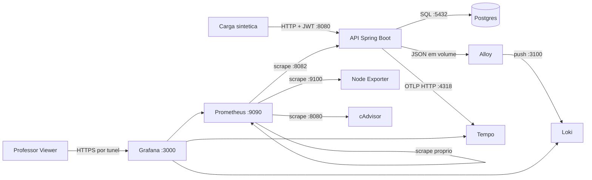

# Entrega de observabilidade - HemoTrack

Esta entrega atende ao enunciado de Infraestrutura de Comunicacao: Actuator,
Prometheus, Grafana, Node Exporter, cAdvisor, Loki, Tempo e correlacao log/trace.
A aplicacao Java avaliada e `backend`; o frontend React nao e outra aplicacao Java.
O Grafana Cloud antigo era uma configuracao de metricas OTLP, sem a stack completa.
O laboratorio usa Prometheus e habilita traces apenas no perfil `observabilidade`.

## Subir do zero

Requisitos: Docker Desktop em execucao (macOS/Windows) ou Docker Engine e Compose
em Linux. Reserve memoria para toda a stack; o build roda os testes Java.

```sh
cp .env.example .env
# Preencha POSTGRES_PASSWORD, JWT_SECRET (32+ caracteres), ADMIN_EMAIL,
# ADMIN_SENHA e GRAFANA_ADMIN_PASSWORD com valores proprios.
docker compose up -d --build
docker compose ps
docker compose logs --tail=20 carga
```

Nao execute `cp` se ja tem `.env`: preserve suas credenciais. O primeiro build baixa
as imagens e dependencias; espere a API ficar `healthy`. A carga inicia so depois.
Nomes `api`, `prometheus`, `loki` e `tempo` sao hosts da rede Docker, nao do navegador.

| Servico | Endereco | Acesso |
|---|---|---|
| Grafana | http://localhost:3000 | Login definido no `.env` |
| Sistema React | http://localhost:8081 | Apenas nesta maquina |
| API de negocio | http://localhost:8080 | JWT; apenas nesta maquina |
| Actuator | http://api:8082/actuator/prometheus | Rede Docker, sem porta publicada |
| Prometheus | http://prometheus:9090 | Rede Docker |
| Node Exporter | http://node-exporter:9100/metrics | Rede Docker |
| cAdvisor | http://cadvisor:8080/metrics | Rede Docker |
| Loki | http://loki:3100 | Rede Docker |
| Tempo | http://tempo:3200; OTLP HTTP 4318 | Rede Docker |

A API publica bloqueia `/actuator/**`, mesmo que o caminho exista na porta de
management. O healthcheck do container usa `localhost:8082/actuator/health`.
Grafana, API e frontend so fazem bind em 127.0.0.1. Nunca publique 8082, 9090, 3100
ou 3200 para o professor. Banco, dados e historico usam volumes persistentes.

## Arquitetura e fluxos



Prometheus puxa metricas. Alloy le o arquivo JSON da API por um volume somente de
leitura e envia os logs ao Loki, com `application="hemotrack-backend"`. Nao precisa
de acesso ao socket Docker. O Spring envia os traces diretamente ao Tempo por OTLP.
O `traceId` no JSON permite abrir no Grafana o trace correspondente ao log.
No fluxo HTTP -> consulta de requisicoes -> JDBC, as observacoes de servico e banco
formam spans filhos do span HTTP. O perfil do laboratorio amostra 100% dos traces.

No Docker Desktop, Node Exporter e cAdvisor medem a **VM Linux do Docker**, nao o
macOS/Windows inteiro. Essa limitacao e aceita no enunciado quando explicada.
Os mounts e privilegios de cAdvisor sao para diagnostico da VM/host do laboratorio.

## Dashboards e consultas

Abra Dashboards -> HemoTrack. Os JSONs sao provisionados automaticamente, sem
importacao manual: `grafana/dashboards/hemotrack-aplicacao.json` e
`grafana/dashboards/hemotrack-infraestrutura.json`. Espere 1 a 2 minutos apos subir
para consultas `rate()` terem amostras suficientes. Selecione Last 15 minutes.

Em Explore, selecione **Prometheus** e execute:

```promql
up
sum by (uri) (rate(http_server_requests_seconds_count{application="hemotrack-backend"}[1m]))
hemotrack_requisicoes_criadas_total{application="hemotrack-backend"}
```

Todos os quatro jobs devem retornar `up=1`. Use a consulta `up` no Grafana para
mostrar os targets sem publicar a porta do Prometheus. Para a captura especifica
de Status -> Targets solicitada no PDF, use temporariamente o override local:

```sh
docker compose -f compose.yaml -f compose.evidencias.yaml up -d prometheus
# Abra http://localhost:9090/targets e capture a tela com data/hora.
# Ao terminar, retire a porta publicada recriando o servico sem o override:
docker compose up -d --force-recreate prometheus
```

O override so faz bind em 127.0.0.1, nunca na interface publica.

Em Explore, selecione **Loki**:

```logql
{application="hemotrack-backend"}
{application="hemotrack-backend"} | json | level="WARN"
{application="hemotrack-backend"} | json | traceId != ""
```

Expanda um log de `TelemetriaService` e clique em **Abrir trace no Tempo**. O log de
`consulta` bem-sucedida gera um trace com HTTP, servico e banco. O caso 404 esperado
registra WARN, sem derrubar a API. O datasource Tempo tambem permite voltar aos logs.

## Adicional: metricas de negocio

| Nome Micrometer | Nome Prometheus | Tipo | Significado |
|---|---|---|---|
| `hemotrack.requisicoes.criadas` | `hemotrack_requisicoes_criadas_total` | Counter | Criacoes persistidas com sucesso desde a partida da JVM |
| `hemotrack.requisicoes.consulta` | `hemotrack_requisicoes_consulta_seconds_*` | Timer | Duracao e quantidade das consultas de requisicoes, incluindo erros |

O dashboard de aplicacao tem paineis proprios para as duas metricas. O contador nao
reconstitui o total historico do banco e zera ao reiniciar a JVM. Tags nao incluem
IDs, pacientes, emails ou tokens. Veja `TelemetriaService.java` e `RequisicaoService.java`.

## Carga e validacao

`scripts/carga.py` roda automaticamente no Compose: cadastra/aprova uma instituicao de carga pelo fluxo real e autentica com
o administrador da instituicao; a cada 2s lista requisicoes e consulta um ID inexistente (404 esperado).
Aproximadamente a cada minuto cria uma requisicao sintetica e a exclui em seguida.
Isso exercita o codigo real e evita crescer indefinidamente o banco. Os dados sao
de demonstracao; este gerador nao deve apontar para a API de producao do Render.
Se a API reiniciar, o script renova a autenticacao.

```sh
docker compose exec -T carga python /scripts/verificar.py
# Exibe JSON datado: quatro targets UP, logs com traceId, trace com varios spans
# e contador de negocio maior que zero. Aguarde alguns scrapes antes de executar.
cd backend
./mvnw verify
```

## Professor: acesso remoto e usuario Viewer

Crie no Grafana um usuario para o professor (Administration -> Users and access ->
Users). Confirme que a funcao da organizacao e **Viewer**, e nao Editor/Admin.
No Grafana 11.6, `viewers_can_edit=true` libera Explore e edicoes temporarias
no navegador; o Viewer continua sem permissao de salvar dashboards ou administrar.
O script `python3 scripts/criar_viewer.py` faz isso com senha aleatoria e salva as
credenciais somente em `docs/acesso-professor.local.txt` (ignorado pelo Git).

O perfil opcional `remoto` abre um Quick Tunnel HTTPS exclusivamente para Grafana:

```sh
docker compose --profile remoto up -d tunnel
docker compose logs tunnel
```

Copie a URL `https://....trycloudflare.com` para o documento privado do professor.
O Quick Tunnel e temporario: a URL pode mudar se reiniciar, sem garantia de uptime.
Para corrigir por varios dias, prefira um tunel nomeado ou uma VM ja disponivel.
No Mac: energia conectada, Docker aberto, impedir repouso e nao fechar a tampa.
Teste em outro acesso de internet, com o usuario Viewer. Informe URL, usuario,
senha e periodo no PDF privado/Classroom, nunca no README ou no Git.
Para parar so o acesso publico: `docker compose --profile remoto stop tunnel`.

## Evidencias e encerramento

Capturas devem mostrar data/hora e dados reais: Compose ps; endpoint Prometheus;
Status -> Targets; consulta PromQL; os dois dashboards; Loki; trace com spans;
navegacao log -> trace; acesso Viewer. Salve em `docs/evidencias/observabilidade/`.
Nao confunda os prints E1/E2/E3 de outra disciplina com estas evidencias.

O PDF final precisa de capa/equipe, descricao, diagrama, tabela de metricas,
evidencias, URL/Viewer/periodo e meia pagina de dificuldades/licoes. O relatorio
publico nao inclui senhas. A copia para Classroom pode incluir as credenciais.
O guia `APRESENTACAO.md` traz a ordem da demonstracao e falas para o grupo.

`docker compose stop` pausa o ambiente; `docker compose up -d` retoma.
`docker compose down` remove containers e rede, mas preserva dados. Evite `down -v`:
ele apaga banco, dashboards salvos e historico dos servicos.

## Referencias tecnicas

- Spring Boot 4.1 tracing: https://docs.spring.io/spring-boot/4.1/reference/actuator/tracing.html
- Grafana Loki datasource: https://grafana.com/docs/grafana/latest/datasources/loki/configure/
- Grafana Tempo: https://grafana.com/docs/tempo/latest/configuration/

## Compatibilidade do cAdvisor

A imagem usada e `ghcr.io/google/cadvisor:0.60.4`, com suporte ao Docker 29.
No Docker Desktop deste laboratorio, o containerd da VM esta em
`/run/containerd/containerd.sock`; o cAdvisor acessa pelo mount `/rootfs`.
Se seu host Linux usar outro local, defina `CADVISOR_CONTAINERD_SOCKET` no `.env`
com o caminho visto de dentro do cAdvisor (exemplo:
`/rootfs/run/docker/containerd/containerd.sock`). O socket Docker e montado
explicitamente apenas no cAdvisor; o Alloy continua lendo apenas o volume de logs.

## Antes de integrar a main (Render)

A API passa a oferecer `GET /health` com apenas o status agregado (HTTP 200/503).
No painel do Render, altere Health Check Path de `/actuator/health` para `/health`
antes do merge/deploy. O Actuator completo permanece interno em 8082. O laboratorio
nao modifica automaticamente o painel do Render nem seus segredos.

## Documentos para o grupo

- [Guia de apresentacao em PDF](guia-apresentacao.pdf)
- [Relatorio publico em PDF](relatorio.pdf)
- [Estado da entrega e pendencias](STATUS.md)

A copia privada para Classroom, com credenciais Viewer, foi entregue fora do Git.
As alteracoes estao na branch `entrega-final-observabilidade`.
Link para revisao da entrega:
https://github.com/miglitopictures/hemotrack/compare/main...entrega-final-observabilidade?expand=1
